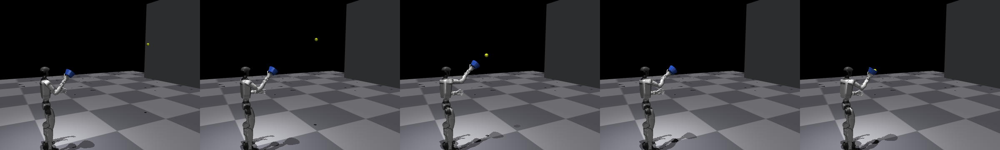
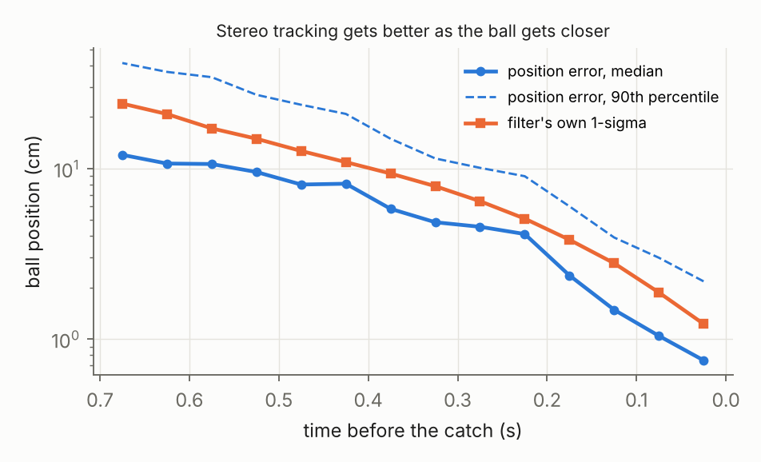
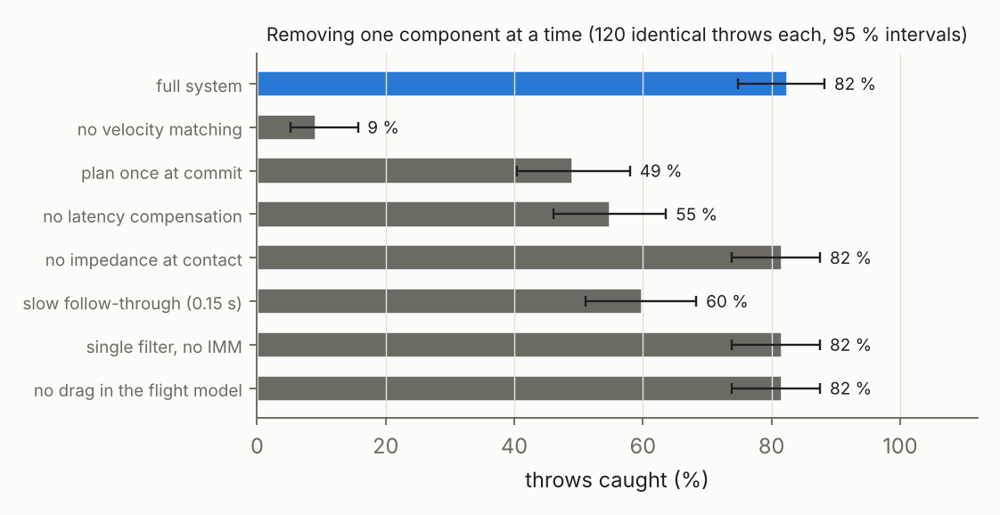
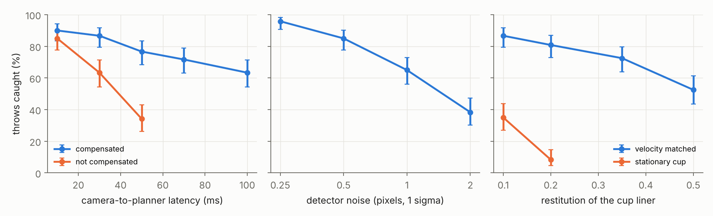
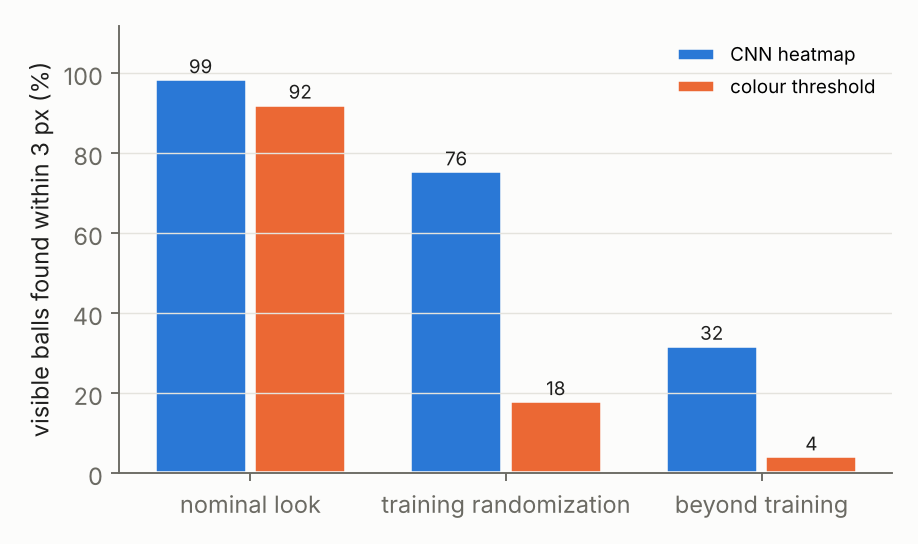
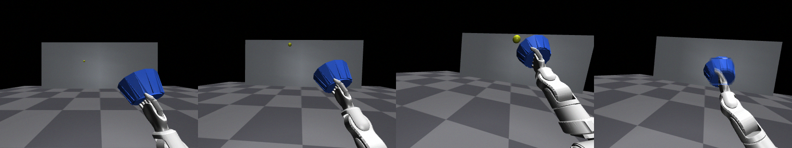
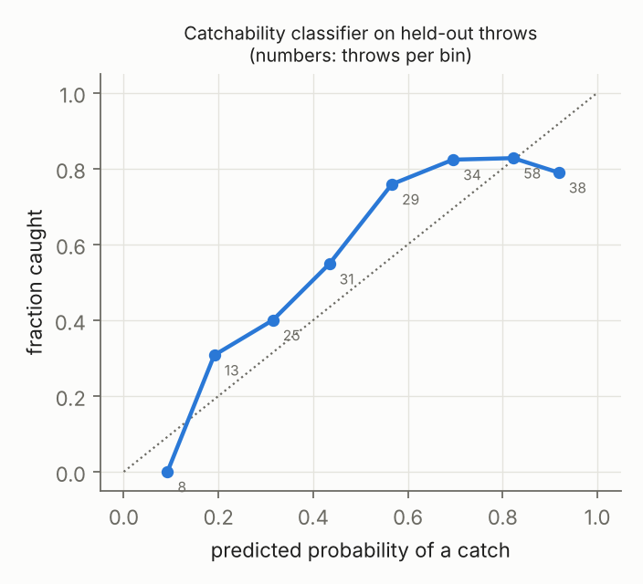
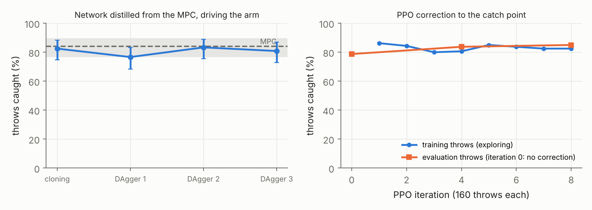
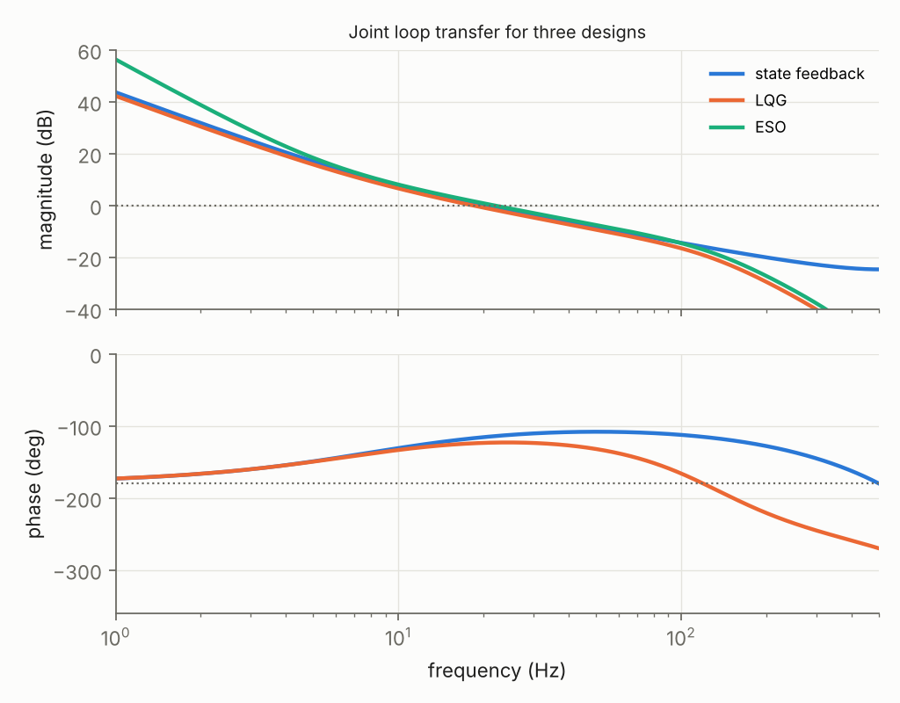
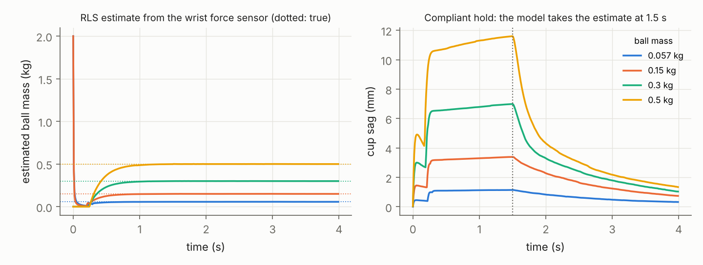

# G1 Catch: Catching a Thrown Ball from Stereo Vision on a Simulated Humanoid

A simulated Unitree G1 upper body catches a thrown tennis ball in a cup on its right hand, using only two cameras in its head. The ball is in the air for 0.55 to 0.85 s. Camera frames arrive 30 ms late and a plan needs another 10 ms to take effect. The arm has to put a 15 cm cup on the ball's path, moving with the ball, at a time it chose a third of a second earlier from a forecast that was still 30 cm uncertain.

The pipeline is a convolutional detector trained on randomized synthetic images, an unscented Kalman filter with two motion models, an intercept planner with prioritised inverse kinematics, a model predictive controller that re-plans the reach every camera frame, and a 1 kHz torque loop that runs LQG computed torque during the reach and operational-space impedance around the catch. The planner's hot path is C++. On top of that sit four learned components, each compared against the model-based part it replaces or corrects: a Gaussian process and boosted trees for aerodynamic drag, a logistic classifier that predicts whether a throw can be caught, a neural network distilled from the MPC with DAgger, and a PPO policy that corrects the catch point.

Measured over seeded throws in simulation:

- **Catch rate.** 249 of 300 direct throws caught (83 %, 95 % interval 78 to 87 %) with a pixel-noise sensor model, quantized encoders and a planning delay. With rendered images and the CNN in the loop, 58 of 60 (97 %, interval 89 to 99 %).
- **What matters most.** Without velocity matching the rate is 9 %. Planning once at commit gives 49 %. Dropping latency compensation at 30 ms gives 55 %. Without the outlier gate, 5 % false detections take it from 81 % to 12 %.
- **What does not matter.** The impedance switch at contact, the second motion model on direct throws, encoder resolution down to 12 bits, and link masses wrong by up to 50 % each leave the rate where it was.
- **Deep learning against the classical detector.** Under the lighting the colour threshold was tuned for, both catch 97 to 98 %. Under randomized appearance the CNN catches 83 % and the threshold 8 %.
- **Learned against model-based.** A network distilled from the MPC catches about as often (80 % against 84 %) and plans in half the time once a barrier-function filter has given it the joint limits it lacks. A GP recovers the drag term from data and matches the physics model. A PPO correction scored 85 % against 79 %, which is not significant on 160 throws (p = 0.12).
- **What fails.** Bounce passes: 21 of 120 caught. A ball-coloured object in a cluttered scene still halves the catch rate. Choosing the catch point takes 15 ms, longer than the 10 ms the runtime assumes.

Everything here is simulation. Read [Limitations](#limitations) before reading any number as hardware performance. [THEORY.md](THEORY.md) explains the theory behind each part with the equations the code implements. [REVIEW.md](REVIEW.md) is a staff-level code review of this repository, including the defects it found and what is still open.



## The robot, the ball and the cameras

The robot is the Unitree G1 model from MuJoCo Menagerie (BSD-3-Clause, license in `models/LICENSE.unitree_g1`), reduced to the pelvis, three waist joints and the seven-joint right arm, with the pelvis fixed 0.793 m above the floor. `scripts/build_model.py` adds everything else.

| Item | Model |
|---|---|
| Catcher | A funnel-shaped cup on the wrist, 5 cm radius at the base, 7.5 cm at the rim, 7.5 cm deep, 90 g. Its liner returns about a fifth of the ball's relative speed. |
| Ball | 33 mm radius, 57 g. Quadratic drag with a coefficient drawn per throw from 0.40 to 0.60, and a Magnus force from up to 25 rad/s of spin per axis. Neither is known to the robot. |
| Cameras | Two in the head, 10 cm apart, level, 90° vertical field of view, 400 by 300 pixels (focal length 150 px), 60.6 Hz. Images are rendered, blurred along the ball's image motion over a 4 ms exposure, and given gain and noise. |
| Latency | A frame captured at time t reaches the tracker at t + 30 ms. A plan made from it takes effect 10 ms after that. |
| Joint sensing | 15-bit encoders (0.19 mrad per count). Velocity is estimated by a steady-state Kalman filter on each joint. |
| Torque loop | 1 kHz. Torque limits are 25 N m at the shoulder, elbow and wrist roll, 5 N m at wrist pitch and yaw, and 50 to 88 N m at the waist. Every joint has 0.3 N m of Coulomb friction. |
| Throws | Released 2.8 to 3.8 m in front of the robot, up to 0.8 m to either side, aimed (without drag) at a 20 by 40 by 45 cm box in front of the right shoulder. |

A throw counts as caught if the ball's centre is inside the cup's volume and moving with it 0.6 s after the planned catch time.

Stereo geometry sets the difficulty. Depth error grows with the square of range, $\sigma_Z = Z^2\sigma_d/(f b)$. With this rig a third of a pixel of disparity noise is 20 cm of depth at 3 m and 2 cm at 1 m. The robot therefore has to start moving on a poor forecast and correct as the ball approaches.

## Architecture

```
 60 Hz, 30 ms late                         60 Hz                               1 kHz
┌──────────────────┐  pixels  ┌─────────────────────┐  forecast  ┌──────────────────────────┐
│ stereo render    │ ───────▶ │ BallTracker         │ ─────────▶ │ intercept choice + IK    │
│ CNN detector     │          │ two UKFs in an IMM  │            │ ReachMpc (QP, OSQP)      │
│ (or pixel noise) │ ◀─────── │ gate, forecast      │            └────────────┬─────────────┘
└──────────────────┘  search  └─────────────────────┘                         │ joint trajectory
                      window                                                  ▼
                                                              ┌──────────────────────────────┐
                                                              │ ArmController                │
                                                              │ reach: LQG computed torque   │
                                                              │ catch: task-space impedance  │
                                                              │ after: turn the cup upright  │
                                                              └──────────────────────────────┘
```

| Module | What it does |
|---|---|
| `g1catch/vision.py` | Pinhole projection, triangulation by the direct linear transform, first-order triangulation covariance, colour-threshold baseline detector. |
| `g1catch/detector.py` | Two-level U-Net (54,809 weights) that outputs a per-pixel heatmap of the ball centre. Sub-pixel peak by windowed centroid. Runs on the full frame until a track exists, then on a 96 pixel window around the predicted position. |
| `g1catch/render.py` | Offscreen stereo rendering with randomized lighting, colours, gain, noise, a ball-coloured distractor and motion blur. |
| `g1catch/ballistics.py`, `cpp/flight_core.cpp` | Flight model with gravity, quadratic drag and a floor bounce, integrated with RK4. The NumPy version is the reference. The C++ version (pybind11) is what the tracker calls, 45 times faster on a one-second forecast and held to the reference by parity tests. |
| `g1catch/ukf.py`, `g1catch/imm.py` | UKF on position and velocity with the four stereo pixel coordinates as the measurement. Two filters (flight, impact) in an interacting-multiple-model estimator whose transition probabilities depend on height. Chi-squared gate. Forecast with covariance from any start time, which is how latency is compensated. |
| `g1catch/intercept.py` | Ranks points on the forecast by hand travel, uncertainty and distance from the workspace edge, and keeps the cup from opening downward. Prioritised damped least-squares IK: cup position first, cup aim second, posture third. |
| `g1catch/mpc.py` | Shrinking-horizon QP over joint accelerations with acceleration, velocity and position limits and a soft terminal state at the catch. |
| `g1catch/control.py` | Arm dynamics from MuJoCo, discrete LQR gains for the joint loop, computed torque, operational-space impedance with a dynamically consistent null-space posture task, and two optional robust terms (disturbance cancellation, sliding mode). |
| `g1catch/runtime.py` | One throw on a shared clock: cameras, perception latency, tracker, planner and torque loop in lockstep with the simulator. |
| `g1catch/residual.py` | Gaussian process and gradient-boosted trees for the aerodynamic residual. |
| `g1catch/catchability.py` | Logistic regression that predicts a catch from what the planner knows at commit time. |
| `g1catch/policy.py` | Per-joint network that imitates the MPC, trained with DAgger. |
| `g1catch/ppo.py` | PPO correction to the catch time and position. |
| `g1catch/joints.py` | Encoder quantization and three joint observers: differenced velocity, a Kalman filter (which makes the joint loop LQG), and an extended-state observer that also estimates a lumped disturbance. |
| `g1catch/safety.py` | Closed-form safety filter for joint limits from a braking-distance control barrier function. It sits behind the learned policy. |
| `g1catch/ilqr.py` | Control-limited iterative LQR, used offline on the full arm dynamics. |
| `g1catch/adaptive.py` | Recursive least squares for the caught mass from a wrist force sensor. |

The catch itself has three phases. During the reach the MPC's joint trajectory is tracked by computed torque. From 30 ms before the planned catch until 80 ms after it, the cup follows the same trajectory under a task-space impedance. Then the arm turns the cup upright so the ball settles on the base.

The planner asks the cup to be moving along the ball's velocity at the catch, at 45 % of the ball's speed (up to 2 m/s), and to brake within 30 ms afterwards. [THEORY.md](THEORY.md#6-rigid-body-dynamics-and-nonlinear-control-g1catchcontrolpy) explains why this, and not compliance, is what keeps the ball in the cup.

## How to run

```bash
pip install -r requirements.txt && pip install --no-deps -e .     # builds the C++ flight core (needs a C++17 compiler)
sudo apt-get install libosmesa6            # software OpenGL for the head cameras
export MUJOCO_GL=osmesa PYOPENGL_PLATFORM=osmesa

python -m pytest -q                        # 71 tests, about 2.5 min (one renders 10 throws)
python scripts/run_experiments.py          # catch-rate experiments with the pixel-noise sensor
python scripts/model_error.py              # wrong link masses and camera calibration, robust controllers
python scripts/planner_timing.py           # planner wall time against its budget
python scripts/tune.py                     # tuning grid on the development seeds
python scripts/train_detector.py           # render the dataset and train the CNN
python scripts/eval_detector.py            # CNN against the colour threshold
python scripts/vision_in_loop.py           # catching from rendered images
python scripts/residual_models.py          # GP and boosted trees for drag
python scripts/catchability.py             # catchability classifier and gate
python scripts/train_policy.py             # DAgger
python scripts/train_ppo_residual.py       # PPO correction
python scripts/margins.py                  # loop margins and the delay sweep
python scripts/adaptive_payload.py         # payload estimation
python scripts/ilqr_check.py               # torque feasibility of the MPC's plans
python scripts/make_figures.py
```

Or with Docker: `docker build -t g1catch . && docker run --rm g1catch` builds the image and runs the tests.

Every experiment is seeded. Conditions that are compared with each other run the same throws.

## Results

Unless a line says otherwise, perception in these experiments is a pixel-noise model: the true ball position is projected into each camera, 0.5 px of Gaussian noise is added per axis, and 2 % of detections are dropped. The CNN's measured error on rendered frames is 0.37 px RMS per axis. The pixel-noise model does not include the arm occluding the ball or false detections, and "Catching from rendered images" below runs the real pipeline to check it.

Conditions inside one table ran the same seeded throws, and p-values are exact McNemar tests on those throws. Different tables use different seeds, so a "full system" row can differ by a few points from one table to the next. With 120 throws the 95 % interval is about ±7 points.

### Baseline

| | |
|---|---|
| Caught | 249 of 300 (83.0 %, 95 % interval 78.3 to 86.8 %). 81.3 % and 84.7 % on the two seeds of 150. |
| Ball passes within 3 cm of the cup centre | 79 % of throws (median closest approach 1.3 cm) |
| Forecast error of the catch point, at the catch | median 1.2 cm, 90th percentile 2.4 cm |
| Cup position error across the ball's path, at the catch | median 1.4 cm, 90th percentile 3.6 cm |
| Aim error of the cup axis | median 1.6°, 90th percentile 5.9° |
| Joint tracking error during the reach | median 1.4 mrad, 90th percentile 2.2 mrad |
| Commit to catch | median 0.35 s |

Of the 51 failures, 30 reached the ball (within 3 cm) and lost it again, and 21 did not get the cup there. None was refused.

Joint tracking is not what limits accuracy. 1.4 mrad at the joints is about half a millimetre at the cup, while the cup is 1.4 cm from the planned point. That gap is the planner's: the catch point keeps moving as the forecast improves, and the last corrections arrive when the arm no longer has time to follow them inside its acceleration limits.

Torque: no throw had a torque limit active during the reach. In 83 % of throws a limit was reached afterwards, during the hard brake and the move that turns the cup upright, most often at the shoulder pitch joint (199 of 248 throws). Robot bodies touched each other in 13 of 300 throws (4.3 %). The planner refuses catch configurations that collide, but does not check the path to them or the moves after the catch.

An earlier version of this repository, with exact joint state, no planning delay and a cup aimed straight against the ball, caught 267 of the same 300 throws. The realism ablations below move the rate by at most 3 throws in 120, so they do not explain a drop of 18. I have not isolated which change does.



The tracker's position error falls from about 12 cm two thirds of a second before the catch to 0.75 cm at the catch, and its own 1-sigma stays above the median error throughout.

### Ablations



| Condition | Caught of 120 | 95 % interval | p |
|---|---|---|---|
| Full system | 99 (82.5 %) | 75 to 88 | |
| No velocity matching (cup at rest at the catch) | 11 (9.2 %) | 5 to 16 | 6e-27 |
| Plan once at commit, no re-planning | 59 (49.2 %) | 40 to 58 | 5e-8 |
| No latency compensation | 66 (55.0 %) | 46 to 64 | 2e-6 |
| Slow follow-through (brake over 0.15 s, not 0.03 s) | 72 (60.0 %) | 51 to 68 | 1e-7 |
| No impedance at contact (computed torque throughout) | 98 (81.7 %) | 74 to 88 | 1 |
| Single filter, no IMM | 98 (81.7 %) | 74 to 88 | 1 |
| No drag in the flight model | 98 (81.7 %) | 74 to 88 | 1 |

The stationary cup still gets to the ball (closest approach 0.9 cm). The ball hits the base at 4.3 m/s and leaves. With one plan made at commit the catch point is 17 cm off in the median, which is the forecast error at commit time.

The impedance result has a physical reason (see [THEORY.md](THEORY.md)): the cup's effective mass along its axis is 2.7 kg against a 57 g ball, so the impact is over before any stiffness setting matters.

### What an imperfect robot costs

The default configuration already has 15-bit encoders, an estimated joint velocity and a 10 ms planning delay. Each row changes one of those.

| Condition | Caught of 120 | p |
|---|---|---|
| Default | 94 (78.3 %) | |
| True joint state (no quantization, no observer) | 94 | 1 |
| Velocity by differencing and a low-pass filter | 94 | 1 |
| 12-bit encoders | 95 | 1 |
| No planning delay | 97 | 0.38 |
| 20 ms planning delay | 94 | 1 |
| 35 ms planning delay | 65 (54.2 %) | 2e-5 |
| No self-collision check on the catch configuration | 94 | 1 |

Joint sensing is not a constraint at this resolution. The planning delay is free up to 20 ms and expensive at 35 ms.

### Wrong link masses, and three joint controllers

The controller's copy of the robot has every link's mass and inertia scaled by a random factor within the stated error. The simulated robot keeps the true values. 80 throws per cell.

Default joint loop (12 Hz natural frequency):

| Mass error | LQG computed torque | + disturbance observer | + sliding mode |
|---|---|---|---|
| 0 % | 65 caught, tracking 1.2 mrad | 66, 1.1 mrad | 65, 1.1 mrad |
| 30 % | 66, 1.4 mrad | 66, 1.2 mrad | 66, 1.2 mrad |
| 50 % | 66, 2.0 mrad | 66, 1.3 mrad | 65, 1.7 mrad |

Soft joint loop (4 Hz), as one might run on hardware with unmodelled flexibility:

| Mass error | LQG computed torque | + disturbance observer | + sliding mode |
|---|---|---|---|
| 0 % | 67 caught, tracking 3.3 mrad | 67, 2.6 mrad | 66, 2.0 mrad |
| 30 % | 68, 5.9 mrad | 67, 3.0 mrad | 66, 2.7 mrad |
| 50 % | 68, 9.6 mrad | 65, 4.3 mrad | 65, 4.4 mrad |

Tracking is the median over throws of the largest joint error during the reach.

Link masses wrong by half do not change the catch rate. The feedback loop absorbs the error: its gain margin is a factor of 9 (see the margin table), and a mass error is a gain error. The two robust terms do what they are designed to do. At the soft loop with 50 % error they cut tracking error from 9.6 mrad to about 4.3 mrad. That improvement is invisible in the catch rate because even 9.6 mrad is 3 mm at the cup, against 14 mm from the planner. On this task robust joint control is solving a problem that is not the bottleneck.

### Wrong camera calibration

80 throws per condition, same throws as the mass-error table.

| Calibration error | Caught of 80 | Forecast error at the catch, median |
|---|---|---|
| None | 65 | 1.10 cm |
| Stereo vergence 0.05° | 67 | 0.98 cm |
| Stereo vergence 0.1° | 68 | 0.91 cm |
| Stereo vergence 0.2° | 68 | 0.82 cm |
| Stereo vergence 0.4° | 69 | 2.10 cm |
| Head pitch 0.5° | 68 | 1.16 cm |
| Head pitch 1° | 64 | 1.42 cm |
| Head pitch 2° | 61 | 1.83 cm |

I expected vergence error to be the dangerous one, because it biases depth. It is not, up to 0.4°. A vergence error biases depth by an amount that grows with the square of range, so the bias is large when the ball is far and shrinks as it approaches, and the filter's late measurements pull the estimate back. Head pitch shifts every measurement the same way at every range and does cost catches: 4 fewer at 2°. I did not test errors in the baseline length or the focal length.

### Sweeps



| Latency, compensated | 10 ms | 30 ms | 50 ms | 70 ms | 100 ms |
|---|---|---|---|---|---|
| Caught of 120 | 90.0 % | 86.7 % | 76.7 % | 71.7 % | 63.3 % |

| Latency, not compensated | 10 ms | 30 ms | 50 ms |
|---|---|---|---|
| Caught of 120 | 85.0 % | 63.3 % | 34.2 % |

| Detector noise (1 sigma) | 0.25 px | 0.5 px | 1 px | 2 px |
|---|---|---|---|---|
| Caught of 120 | 95.8 % | 85.0 % | 65.0 % | 38.3 % |

Sub-pixel detection is a requirement here. Halving the noise from 0.5 px is worth 11 points.

| Restitution of the cup liner | 0.1 | 0.2 | 0.35 | 0.5 |
|---|---|---|---|---|
| Caught of 120, velocity matched | 86.7 % | 80.8 % | 72.5 % | 52.5 % |
| Caught of 120, stationary cup | 35.0 % | 8.3 % | | |

The liner's restitution is a design choice of mine and the headline number depends on it. The project uses 0.2. A passive cup with a harder liner needs a closing hand.

### Outlier rejection

With 5 % of detections replaced by a uniformly random pixel, the gated tracker catches 97 of 120 (80.8 %). With the chi-squared gate switched off it catches 14 of 120 (11.7 %, p = 5e-23).

### Bounce passes

Throws that hit the floor once and rise into the catch zone.

| Condition | Caught of 120 | p |
|---|---|---|
| IMM tracker, cup aim kept at least 20° above horizontal | 21 (17.5 %) | |
| Single filter | 26 (21.7 %) | 0.46 |
| Cup aimed straight against the ball | 5 (4.2 %) | 1e-4 |

A ball that is still rising asks a cup aimed against its velocity to open downward, and the ball falls out. Keeping the aim's vertical component at 0.35 or more (about 20° above horizontal) and penalising rising catch points quadruples the rate, which confirms that explanation. It is still a poor result. The ball now passes within 3 cm of the cup centre in only 29 % of these throws, against 53 % in the previous version with the straight aim, so the constraint traded retention for reach. Bounce throws arrive fast, late and low, and I have not worked out a catch strategy for them. The IMM makes no measurable difference to catching them.

### Detection: CNN against colour threshold

Detection on 400 full frames per condition, with the ball visible in about 280:



| Appearance | Detector | Visible balls found within 3 px | Median error | Detection reported when no ball is visible |
|---|---|---|---|---|
| Nominal | CNN | 98.6 % | 0.30 px | 6 % |
| Nominal | Colour threshold | 92.2 % | 0.68 px | 7 % |
| Training randomization | CNN | 75.5 % | 0.36 px | 37 % |
| Training randomization | Colour threshold | 18.1 % | 1.24 px | 83 % |
| Beyond training, distractor always present | CNN | 31.9 % | 0.39 px | 92 % |
| Beyond training, distractor always present | Colour threshold | 4.3 % | 1.77 px | 99 % |

These are single-detection numbers: the strongest peak in each image. The CNN is trained on 14,000 rendered 96 pixel crops with random lighting, colour, gain, noise, blur and arm posture. On the validation crops its median error is 0.35 px and it misses 0.4 % of visible balls. It takes 60 ms on a full frame and 6 ms on the tracking window on one CPU core.

The last column is the detector's weakness. The randomization includes a ball-coloured sphere on the far wall in 30 % of scenes, and neither detector can tell it from the ball. The pipeline handles this downstream. The CNN reports up to three peaks per image, the tracker tries every left-right pair and starts a track only from a pair that triangulates inside the volume a throw can come from with rays that meet, and once a track exists the detector only looks near the prediction.

### Catching from rendered images

The same 60 throws, with every frame rendered and passed through a detector:

| Sensor | Caught | 95 % interval | Committed to a catch |
|---|---|---|---|
| Pixel-noise model | 51 / 60 = 85.0 % | 74 to 92 | 98 % |
| CNN, nominal appearance | 58 / 60 = 96.7 % | 89 to 99 | 98 % |
| Colour threshold, nominal appearance | 59 / 60 = 98.3 % | 91 to 100 | 98 % |
| CNN, randomized appearance | 50 / 60 = 83.3 % | 72 to 91 | 85 % |
| Colour threshold, randomized appearance | 5 / 60 = 8.3 % | 4 to 18 | 18 % |
| CNN, beyond training with distractor | 29 / 60 = 48.3 % | 36 to 61 | 58 % |
| Colour threshold, beyond training with distractor | 0 / 60 | 0 to 6 | 8 % |

Under the nominal look the classical detector is as good as the learned one, and both beat the pixel-noise model, which is therefore pessimistic. The learned detector earns its place when the appearance changes. In the previous version of this repository, before tracks were started from several candidates per image, the two harder CNN rows were 73 % and 38 % on the same throws.



### Learned drag: Gaussian process and boosted trees against physics

Suppose the flight model had gravity only. 15,121 samples of residual acceleration from 150 calibration throws (reference positions at 200 Hz with 2 mm noise, standing in for motion capture) are used to fit a GP on 200 points and gradient-boosted trees on all of them.

| Flight model | 0.3 s forecast error, median | 90th percentile | Cost per call |
|---|---|---|---|
| Gravity only | 1.69 cm | 2.30 cm | |
| Gravity + nominal drag (physics) | 0.51 cm | 0.76 cm | |
| Gravity + GP | 0.54 cm | 0.81 cm | 110 µs |
| Gravity + boosted trees | 0.51 cm | 0.85 cm | 663 µs |

Both learned models recover the drag and match the physics term. Neither beats it, because what is left comes from the per-throw drag coefficient and the spin, which a function of velocity cannot know. Outside the training data they behave differently. At 15 m/s, three times any velocity in the data, the true drag is 4.1 m/s². The GP returns 0.1 m/s² with a predictive standard deviation of 0.36, about ten times its value inside the data, so it reports that it does not know. The trees return 0.69 m/s² with no warning.

Does it matter for catching? The evidence is mixed. On one batch of 120 throws, gravity only caught 95, the physics drag term 104 and the GP 110 (gravity against GP p = 0.008, physics against GP p = 0.26). On the ablation batch above, a different 120 throws, removing drag changed nothing (98 against 99). A drag model is worth somewhere between nothing and 12 points depending on the throws, and I cannot narrow that with these sample sizes. The GP is not used by default because a learned residual is a Python callable and takes the tracker off its compiled path.

### Catchability classifier

Throws aimed at a box much larger than the arm's reach, 400 for training and 300 for testing. Of the 236 test throws the planner committed to, 159 were caught.

| Model | AUC | Brier score | Accuracy at 0.5 |
|---|---|---|---|
| Always predict the base rate | 0.50 | 0.221 | 67.4 % |
| Logistic regression, 13 features | 0.73 | 0.187 | 73.7 % |
| Gradient-boosted trees, same features | 0.68 | 0.209 | 67.4 % |



Used as a gate on 200 new throws:

| | Attempts | Caught | Failed attempts | Throws with a self-collision |
|---|---|---|---|---|
| No gate | 163 | 112 | 51 | 31 |
| Gate at 0.5 | 118 | 88 | 30 | 19 |

The gate avoids 21 failed attempts and 12 self-collisions at the price of 24 catches. Whether that is worth it depends on what a failed attempt costs. On this robot, where a failed attempt outside the workspace often means the arm hits the body, there is a case for it. The largest standardised weights are hand travel, the catch point's forward and sideways offset from the shoulder, and timing slack.

### DAgger: a network in place of the MPC

A per-joint network (10,273 weights) is trained on the MPC's first action. Round 0 is behaviour cloning on states the MPC visits. Later rounds label the states the network itself visits.

| | Training samples | Caught of 120 |
|---|---|---|
| MPC | | 101 (84.2 %) |
| Behaviour cloning | 20,160 | 99 (82.5 %) |
| DAgger round 1 | 39,680 | 92 (76.7 %) |
| DAgger round 2 | 59,450 | 100 (83.3 %) |
| DAgger round 3 | 79,680 | 97 (80.8 %) |
| Round 3, barrier filter removed | | 97 (80.8 %) |
| Round 3, barrier filter in its final closed form | | 96 (80.0 %) |

All rows are within each other's intervals (about ±7 points). Behaviour cloning was already good enough here, so this experiment does not show DAgger fixing a distribution-shift failure. The joints are decoupled, the horizon is short, and re-planning from the reference state every frame keeps the network close to states it has seen.

| On 300 random reach problems | MPC | Network | Network + barrier filter |
|---|---|---|---|
| Time per plan | 3.7 ms | 1.3 ms | 1.6 ms |
| Plans that leave the joint range | 5 % | 51 % | 5 % |
| Terminal position error, median | 0.011 rad | 0.018 rad | 0.024 rad |

The network alone has no notion of a joint limit and leaves the range in half of these problems. The barrier filter (section 13 of [THEORY.md](THEORY.md)) brings that to the MPC's level, where the remaining 5 % are problems whose start state is already outside the planning margin. With the filter the network still plans in less than half the MPC's time, and its goal accuracy is a little worse because the filter overrides it near limits.

### PPO correction to the catch point

One decision per throw: a shift of the catch time (±30 ms) and of the catch point across the ball's path (±3 cm), from the planner's commit features. Eight iterations of 160 throws.



| Robot | Without correction | With correction | Caught only without / only with | p |
|---|---|---|---|---|
| Nominal | 126 of 160 | 136 of 160 | 12 / 22 | 0.12 |
| Head pitch miscalibrated by 2° | 134 of 160 | 140 of 160 | 11 / 17 | 0.34 |

The second row is there because a learned correction should do best where the model-based pipeline has a systematic error, and a pitch error is one. It did not do better there. In both runs the policy's exploration noise did not shrink during training (0.30 throughout), so it had not converged. I report this as no demonstrated improvement. 1,280 training throws is a small budget.

### Loop margins for three joint-loop designs



Computed torque leaves each joint as a double integrator. The discrete LQR design at 1 kHz gives $k_p = 5953\ \mathrm{s^{-2}}$ and $k_d = 117\ \mathrm{s^{-1}}$.

| Design | Crossover | Phase margin | Gain margin | Sensitivity peak | Delay margin | Simulation stable through |
|---|---|---|---|---|---|---|
| State feedback on the true state | 20.1 Hz | 64° | ×17 | 1.06 | 8.9 ms | 8 ms |
| LQG (Kalman velocity estimate) | 18.3 Hz | 56° | ×9.0 | 1.23 | 8.5 ms | 8 ms |
| LQG + disturbance observer | 21.8 Hz | 51° | ×7.3 up, ×0.17 down | 1.30 | 6.5 ms | 6 ms |

The last column adds whole milliseconds of actuation delay to the full nonlinear arm in simulation until a small step no longer settles. It agrees with the linear prediction for all three designs.

The table shows the price of each step toward realism. State feedback has the margins the textbook promises for LQR. Putting an observer in the loop removes that guarantee: the gain margin halves and 8° of phase goes. The disturbance observer adds integral action, which costs another 5° and 2 ms of delay margin and makes the loop conditionally stable (the gain may not fall below 0.17 of nominal). The gain margin is also the tolerance to inertia error, since a link that is lighter than modelled raises the loop gain by the same factor. A margin of 9 is why 50 % mass error did nothing above.

### Payload adaptation



A ball of unknown mass rests in the upright cup under a 400 N/m compliant hold. Recursive least squares on the wrist force sensor (0.05 N noise) estimates the mass, and the arm model takes the estimate over at 1.5 s.

| Ball mass | Estimate | Sag before | Sag after |
|---|---|---|---|
| 57 g | 57 g (−0.1 %) | 1.1 mm | 0.3 mm |
| 150 g | 150 g (0.0 %) | 3.4 mm | 0.8 mm |
| 300 g | 300 g (0.0 %) | 6.9 mm | 1.1 mm |
| 500 g | 500 g (0.0 %) | 11.5 mm | 1.4 mm |

The remaining sag is joint friction. For the tennis ball this experiment barely matters. It is included because the same estimator is what a heavier object would need.

### Planner timing

Wall time of every planner call over 80 throws, one process, on an otherwise idle two-core machine. The runtime assumes 10 ms.

| Call | Count | Median | 90th percentile | 99th percentile | Max | Over 10 ms |
|---|---|---|---|---|---|---|
| Choosing the catch point (once per throw) | 80 | 15.2 ms | 20.6 ms | 25.3 ms | 38.4 ms | 95 % |
| Re-planning (every other frame) | 2,947 | 2.1 ms | 4.7 ms | 12.7 ms | 19.1 ms | 2.2 % |

Re-planning fits the budget. The one call per throw that chooses the catch point does not: it runs a one-second forecast and up to four full IK solves and takes 15 ms. That is still inside one 16.5 ms camera frame in the median, and the table above shows a 20 ms planning delay costs no catches, so the honest budget is 20 ms and the 10 ms default is optimistic for that one call. The simulator's clock does not advance while the planner runs, so an overrun is not penalised in the results.

Before this work the planner took 23 ms per frame on average. Moving the flight model to C++ took the one-second forecast from 15.5 ms to 0.35 ms. Keeping one QP solver per horizon length and stopping IK on convergence did the rest. The tracker, IK and MPC are still Python.

### Are acceleration limits a fair stand-in for torque limits?

The MPC plans accelerations and leaves torque to the inner loop. On 40 reach problems from the catch workspace, inverse dynamics along the MPC's plan exceeded a torque limit in 5 % of cases, and 7 % saturated when tracked. The cup arrived within 0.06 cm (median) and 0.35 cm (90th percentile) of its target.

The control-limited iLQR on the full dynamics is the torque-aware alternative. It hit its 60-iteration cap on every problem (3.0 s median) without meeting its convergence tolerance. Where the torque limits were inactive it reached the target exactly. Where they were active its 90th-percentile cup error was 5.8 cm, worse than the MPC. As implemented it is a check on the MPC and not a replacement for it.

### Tuning

`scripts/tune.py` runs a grid over the two parameters that decide whether a ball that reaches the cup stays in it, on development seeds 0 and 1 (100 throws per cell). Every reported result uses seeds of 500 and above. The grid picks a velocity match of 0.45 and a 0.03 s follow-through, which are the defaults. The surface is flat in velocity match from 0.35 to 0.55 (83 to 85 %) and falls off with follow-through time (66 % at 0.12 s).

## What worked

- The division of labour between estimator and planner. The filter reports an uncertainty that tracks its real error, and the planner uses it to decide when to commit and re-plans as it shrinks.
- Feeding pixels to the filter and not triangulated points.
- Velocity matching with a hard brake after contact: 9 % to 83 %.
- Latency compensation by timestamping: 55 % to 83 % at 30 ms.
- The outlier gate: 12 % to 81 % with 5 % false detections.
- Prioritised IK finished with task-only iterations. It solves 99.5 % of the aim box to better than 5 mm.
- Domain randomization for the detector, and starting tracks from stereo pairs that triangulate somewhere plausible. Together they take catching under randomized appearance from 8 % to 83 %.
- The loop analysis. Three designs, three predicted delay margins, three simulations that agree to the millisecond.
- The barrier filter behind the learned policy: joint-range violations from 51 % to 5 % for 0.3 ms.
- The C++ flight core: 45 times faster on the forecast, identical to the reference to 1e-12.
- Tests that caught real defects. See [REVIEW.md](REVIEW.md).

## What did not work

- **Bounce passes.** 17.5 %. The aim fix addressed the cause I had guessed and exposed a reach problem behind it.
- **Compliance as the way to absorb the impact.** No measurable effect for a light ball against a heavy hand.
- **Robust joint control as a way to catch more.** The disturbance observer and sliding mode halve tracking error under model error and change nothing downstream, because tracking was never the bottleneck.
- **The IMM.** Nothing on direct throws, nothing measurable on bounces.
- **PPO.** No significant gain in two settings.
- **DAgger over behaviour cloning.** No measurable difference.
- **iLQR as a planner.** Too slow and not converged when torque limits are active.
- **Boosted trees for catchability.** Worse than logistic regression on held-out throws and no better than the base rate at a 0.5 threshold.
- **The commit-frame time budget.** 15 ms against an assumed 10 ms.
- **Explaining the baseline drop.** 89 % became 83 % between versions and the ablations do not account for it.
- **Cluttered scenes.** 48 % in the hardest appearance condition.

## Limitations

- **Simulation only.** No hardware, no real camera, no real ball.
- **Kinematics are exact.** Link masses can be wrong and that is tested. Link lengths and joint zero offsets are not perturbed, and they move the cup directly.
- **Camera intrinsics and baseline are exact.** Only vergence and head pitch errors are tested.
- **The pixel-noise sensor** behind most numbers does not model occlusion or false detections. The rendered-image experiment (60 throws per condition) is the check on it.
- **The planner's compute time is assumed, not enforced.** See Planner timing.
- **The cup is passive.** The result depends on a liner with restitution near 0.2 and on a 15 cm opening. There are no fingers.
- **Collision checking covers the catch configuration only.** Robot bodies touched in 4.3 % of baseline throws.
- **A wrist force sensor is assumed** for payload estimation. The stock G1 does not have one.
- **Single training runs.** The CNN, the distilled policy and the PPO policies were each trained once with one seed.
- **Throws are synthetic.** Release points, speeds and spin are drawn from uniform ranges, not from recordings of people throwing.
- **Only the flight model is C++.** The tracker, IK, MPC and torque loop are Python.

## Tools

Python 3.13, C++17 with pybind11 (flight core), MuJoCo 3.17 (dynamics, contacts, offscreen rendering through OSMesa, finite-difference linearisation), PyTorch 2.15 on CPU (detector, policies), OSQP 1.1 (MPC), scikit-learn 1.9 (GP hyperparameters, boosted trees, logistic regression), NumPy, SciPy (Riccati equations, statistics), Matplotlib, pytest, ruff, Docker, GitHub Actions.

## Topics from the list used here

- Classical control (1A): PD control, feedforward, saturation handling, Bode plots, gain and phase margin, delay margin, sensitivity function, digital control and sampled-data effects, discrete-time design.
- Linear systems and modern control (1B): state-space models, discrete-time systems, state feedback, observers, the separation principle, LQG.
- Optimal control (1C): LQR, the discrete algebraic Riccati equation (control and filter), iterative LQR, differential dynamic programming with control limits, minimum-time (bang-bang) bounds, trajectory optimization.
- Model predictive control (1D): linear MPC as a QP, shrinking horizon, soft terminal constraints, input, rate and state constraints, warm starting, real-time solve budget.
- Nonlinear control (1E): feedback linearization, sliding-mode control with a boundary layer, control barrier functions (a braking-distance barrier as a safety filter).
- Robust control (1F): model uncertainty (link-mass error), disturbance modelling, disturbance and extended-state observers, gain and phase margins as robustness measures, sensitivity peak, conditional stability, loss of LQR margins under output feedback.
- Adaptive control (1G): recursive least squares with forgetting, online parameter estimation, indirect (self-tuning) adaptation.
- Stochastic control and estimation (1H): Kalman filtering, steady-state Kalman gain, unscented Kalman filter, interacting multiple models, process and measurement noise modelling, quantization noise, innovation gating, NIS and NEES consistency checks.
- Other control paradigms (1I): computed-torque control, operational-space control, impedance control, active disturbance rejection control, safety-critical control, contact-aware control.
- Mathematical foundations (2A): rotation matrices, homogeneous projection, least squares, singular value decomposition, Cholesky factorisation, eigenvalue repair of covariance matrices.
- Rigid-body kinematics (2B): forward kinematics, Jacobians, damped least-squares inverse kinematics, task priority, redundancy resolution, self-collision checking.
- Robot dynamics (2C): mass matrix, bias forces, inverse dynamics, task-space inertia, impact and restitution, Coulomb friction, payload modelling, model error.
- Motion and trajectory generation (2D): piecewise constant-acceleration trajectories, velocity and acceleration limits, intercept planning.
- Sensor modelling and calibration (3A): pinhole camera model, stereo geometry, extrinsic calibration error, encoder quantization, latency, motion blur, measurement noise from a measured detector.
- State estimation (3B): nonlinear filtering, multi-rate fusion, out-of-date measurements, outlier rejection, data association at track start, track loss and restart.
- Classical machine learning (5A): logistic regression, gradient-boosted trees, Gaussian process regression, calibration and reliability curves, ROC AUC, Brier score, train and test splits.
- Deep learning (5B): convolutional networks, U-Net, heatmap regression, data augmentation, training and validation on CPU.
- Reinforcement learning (5C): policy gradients, PPO, contextual bandits, residual policies, reward shaping.
- Learning-based control (5D): imitation learning, behaviour cloning, DAgger, learned residual dynamics, Gaussian-process models, policy distillation from MPC, safety filtering of a learned policy.
- Classical computer vision (6A): colour thresholding, centroid detection, triangulation, camera projection, non-maximum suppression, stereo correspondence by reprojection error.
- Deep computer vision (6B): keypoint detection with heatmaps, sub-pixel localisation, synthetic data, domain randomization.
- Perception engineering (6C): region-of-interest tracking, detector evaluation by range and condition, perception latency.
- Middleware and simulation (7): MuJoCo, MJCF model generation, offscreen rendering.
- Software engineering (8): Python, C++17, pybind11 bindings, parity testing of a compiled core against a reference, Git, Docker, GitHub Actions, pytest, property and regression tests, seeded experiments, ablation studies, paired statistical tests, confidence intervals, profiling, multiprocessing.
- Real-time control (9B): multirate loops, latency and compute budgets, delay margin, measured worst-case planner time.
- Advanced optimization (11): quadratic programming, ADMM (OSQP), finite-difference derivatives, regularised Gauss-Newton.
- Manipulation (13B) and humanoids (13C): dynamic catching, contact and impact, upper-body control of a humanoid.
- System identification and experimental science (14): payload identification, Monte Carlo evaluation, sensitivity to model and calibration error, Wilson intervals, McNemar tests, negative results reported.

## What I learned

- Work out the physics of the contact before choosing the controller for it. I built an impedance controller to soften the catch and then measured that it does nothing, because a 57 g ball cannot move a hand with 2.7 kg of effective mass in 5 ms. The number that mattered was relative velocity, and the fix was in the planner.
- Find the bottleneck before making anything robust. I added a disturbance observer and a sliding-mode term to survive model error, and they work, and the catch rate did not move, because joint tracking was contributing half a millimetre to a 14 mm error. Logging tracking error and planning error separately at the start would have told me where to spend the effort.
- Margins predict what model error will do. A gain margin of 9 said 50 % mass error would be harmless before any simulation was run, and the simulation agreed.
- An observer costs margin. LQR's guaranteed margins belong to state feedback. With a Kalman filter in the loop the phase margin fell from 64° to 56°, and with a disturbance state to 51° and conditional stability.
- A gain is not a stiffness. My first impedance law multiplied its gains by the task inertia, which made the physical stiffness posture-dependent and about equal in the two directions I had meant to differ several-fold. A test that pushed on the cup found it.
- Approximate null-space projectors leak. A posture term projected with damped inverses held the cup 1.5 cm off target near a joint limit.
- Re-choosing a decision every frame is its own failure mode. With the catch time free, the cup retreated in front of the ball indefinitely.
- A pipeline with latency needs a queue wherever a delay can exceed a period. With a 20 ms planning delay and a 16.5 ms frame, each new plan replaced the previous one before it took effect, and the robot never moved. The catch rate was 4 % until plans were queued.
- Fixing the cause you guessed can expose the next one. Tilting the cup upward quadrupled bounce catches and showed that the reach, not the aim, is now what fails.
- A calibration error that shrinks as the target approaches is forgiving. One that is constant is not. Vergence against pitch was the opposite of what I expected.
- A learned component should be compared against the thing it replaces on the task metric, and with a paired test. Most of them tied.
- Report the experiment that was invalid, and the number you cannot explain. My first "gate off" condition did not turn the gate off. And the baseline is 6 points lower than the previous version for reasons I have not found.

## Repository layout

```
g1catch/        the package (see the module table above)
cpp/            the C++ flight core
scripts/        experiments, training, analysis and figures
tests/          71 tests: geometry, ballistics, estimation, control, planning, safety, end to end
models/         g1_catch.xml and the G1 meshes
results/        CSV files, figures, trained weights
THEORY.md       the theory behind each part
REVIEW.md       code review
```
